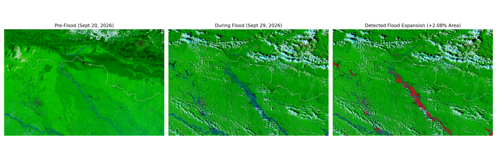

# Satellite Flood Change Detection Prototype (Gandak River, 2026)

A lightweight computer vision prototype for automated pre-/post-disaster flood expansion detection using multi-temporal satellite imagery, Python, and OpenCV.

## Overview
Rapidly mapping inundated zones is a foundational step in post-disaster infrastructure assessment and rescue route planning. This prototype demonstrates a classical image-processing baseline using **NASA Terra/Aqua MODIS false-color imagery (Bands 7-2-1)** from the September 2026 Gandak River floods along the Nepal–India border.

## Pipeline
1. **Spatial Alignment:** Loads and aligns pre-flood (Sept 20, 2026) and during-flood (Sept 29, 2026) satellite frames.
2. **Spectral Change Detection:** Isolates newly inundated areas by detecting sharp drops in the Near-Infrared/Green channel (vegetation transitioning to water) while filtering out high-reflectance cloud cover.
3. **Morphological Filtering:** Applies opening and closing operations (`3x3` kernel) to suppress speckle noise and connect flood regions.
4. **Area Estimation & Overlay:** Quantifies the newly flooded area (`+2.08%` of the frame) and renders a visual change-detection overlay.

## Output

*Data Source: NASA Earth Observatory (MODIS Bands 7-2-1), September 20 & September 29, 2026.*
## Challenges & Iterative Refinements
- **Spectral Ambiguity in HSV Thresholding:** Initial single-frame HSV blue-range thresholding under-detected the flooded Gandak River (which appears dark teal/blue-green in MODIS 7-2-1 imagery) while triggering false positives on light-blue cloud edges.
- **Cloud Interference & Pivot to Differential Change Detection:** Rather than relying on static color bounds, the pipeline was refactored to detect sharp pre-to-post drops in the Green (Near-Infrared) channel—directly capturing the transition from bright green vegetation to water—while applying a Red-channel ceiling to suppress bright cloud cover.

## Limitations

While this prototype demonstrates automated floodwater extraction and expansion quantification on wide river corridors, it highlights several real-world constraints of basic optical remote sensing:

* **Cloud-Cover Dependency:** MODIS optical/false-color imagery requires clear skies, making it unreliable during active monsoon or typhoon storms when rapid disaster assessment is most critical.
* **Coarse Spatial Resolution (~250m):** Effective for broad floodplains like the Gandak River, but too coarse to resolve narrow infrastructure (such as 4–8m mountain roads) or localized debris blockages.
* **Fixed Color-Space Thresholding:** Static HSV masking is sensitive to variations in water turbidity, sediment load, and atmospheric conditions across different capture dates.

## Next Steps

To move from broad floodplain tracking toward actionable post-disaster infrastructure screening, future iterations aim to explore:

* **All-Weather SAR Integration:** Incorporating Synthetic Aperture Radar (e.g., Sentinel-1 / ALOS) alongside higher-resolution optical imagery (Sentinel-2) to enable rapid, cloud-penetrating change detection.
* **GIS Road-Network Overlay:** Integrating vector road data (OpenStreetMap / GSI) to transition from pixel-level water expansion metrics to segment-level road blockage screening.
* **Terrain-Aware Validation:** Accounting for topographic distortion in steep mountainous corridors and benchmarking rapid satellite outputs against high-resolution aerial or 3D terrain datasets.

## Tech Stack
- Python, OpenCV, NumPy, Matplotlib (Google Colab)
